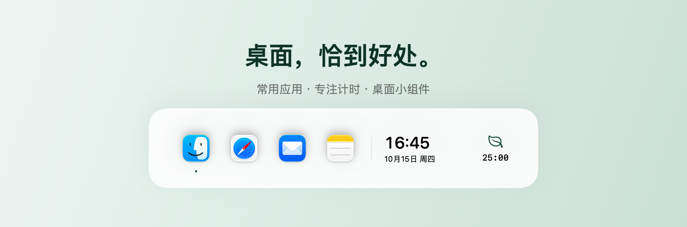
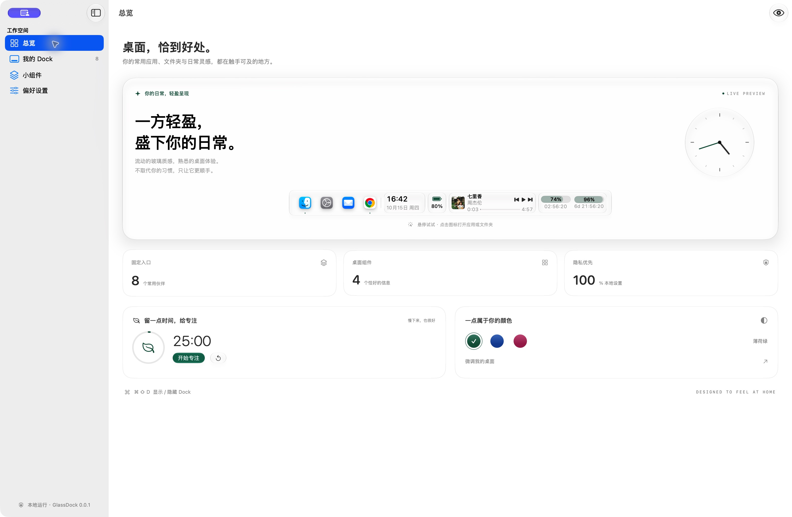
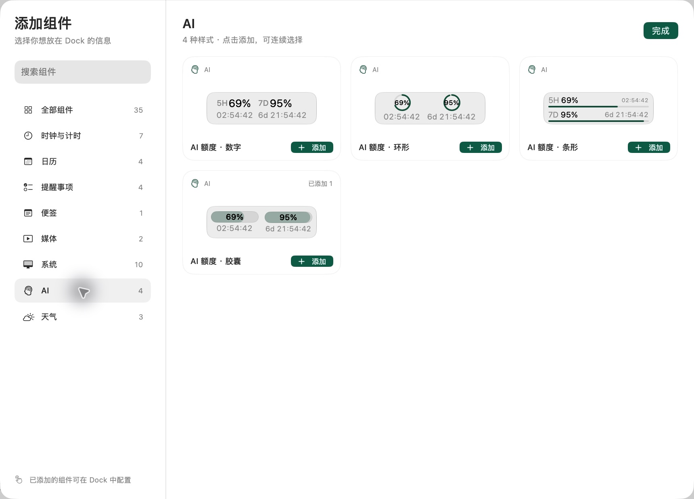

<!-- Copyright 2026 zqxsober. SPDX-License-Identifier: Apache-2.0 -->

<h1 align="center">GlassDock</h1>

<p align="center"><strong>把常用入口和日常信息，放到一条轻盈的 Dock 里。</strong></p>
<p align="center">为 macOS 26+ 打造的原生 Liquid Glass 悬浮 Dock</p>

<p align="center">
  中文 · <a href="README.en.md">English</a>
</p>

<p align="center">
  <a href="https://github.com/zqxsober/GlassDock/releases/latest"></a>
  <a href="https://www.apple.com/macos/"></a>
  <a href="https://swift.org/"></a>
  <a href="LICENSE"></a>
</p>

<p align="center">
  <a href="https://github.com/zqxsober/GlassDock/releases/latest"><strong>下载 DMG</strong></a> ·
  <a href="#快速开始">快速开始</a> ·
  <a href="#小组件">小组件</a> ·
  <a href="https://github.com/zqxsober/GlassDock/issues">反馈问题</a>
</p>

<p align="center">
  
</p>
<p align="center"><sub>原生组件的排版演示；实际系统玻璃效果见下方应用截图。</sub></p>

GlassDock 将常用应用、文件夹、当前屏幕上的应用窗口，以及时钟、音乐、系统状态和 Codex 额度整合在一条可调整的悬浮栏中。你可以只保留应用入口，也可以按自己的工作方式添加组件。

> 当前下载版本为 **v0.0.2**，使用 ad-hoc 临时签名，**未经 Apple 公证**。本版本包含可选的首次启动权限引导；功能以所下载版本的[发布说明](https://github.com/zqxsober/GlassDock/releases)为准。

## 功能概览

| 功能 | 可以做什么 |
| --- | --- |
| 多窗口入口 | 同一应用的多个窗口分别展示，点击进入指定窗口；右键可关闭单个窗口 |
| 常用应用与文件夹 | 固定最多 12 个应用或文件夹，拖动调整排列顺序 |
| 桌面小组件 | 添加时钟、计时、日历、提醒事项、便签、音乐、系统状态和 AI 额度等信息 |
| 尺寸与外观 | 调整 Dock 尺寸（10–96 点）、图标比例、圆角、强调色和悬停放大 |
| 键盘操作 | 快捷键显示、隐藏或聚焦 Dock；在栏内移动焦点并激活入口 |
| 本地配置 | 布局和偏好保存在本机，关闭 GlassDock 即可移除悬浮栏 |

### 多窗口怎么用

1. 在偏好设置中连接窗口管理，并授予“辅助功能”权限。
2. 当同一应用在当前屏幕有多个符合条件的普通窗口时，Dock 会展示独立窗口入口。
3. 点击窗口入口切换到该窗口；右键或按住 Control 点击，可选择“关闭此窗口”。

窗口入口最多显示 8 个字符，超过后显示 `...`；悬停帮助和辅助功能标签保留完整标题。关闭操作只针对选中的窗口，应用自身的保存确认仍需处理。

## 界面预览

<details>
<summary>控制中心：Dock 预览、专注计时与强调色</summary>

<p align="center">
  
</p>

</details>

<details>
<summary>组件选择器：AI 额度的四种样式</summary>

<p align="center">
  
</p>

组件按类别组织，支持搜索和连续添加。截图来自 v0.0.1；额度、时间与播放信息仅代表截图时的状态，实际内容随连接的数据源更新。玻璃效果会随系统外观与桌面背景变化。

</details>

## 小组件

组件选择器提供 **35 种可选样式**，其中 3 种天气样式尚为占位。相同类型可添加多个实例；在 Dock 中右键组件可打开配置，音乐组件可直接控制播放。

| 类别 | 内容 |
| --- | --- |
| 时钟与计时 | 时钟、世界时钟、秒表、专注计时、时间进度、倒计时、闹钟 |
| 日历 | 日期、下一个日程、日期与日程、议程 |
| 提醒事项 | 提醒列表、下一条提醒、未完成数量、喝水提醒 |
| 便签 | 编辑和保存文字便签 |
| 媒体 | macOS“音乐”App 的播放信息、进度及上一首 / 播放暂停 / 下一首 |
| 系统 | 电池状态、CPU 与内存活动、网络速度 |
| AI | Codex 5 小时 / 7 天剩余额度与重置倒计时，提供数字、圆环、条形和双胶囊样式 |
| 系统快捷方式 | 运行指定快捷指令，或选择文件后通过隔空投送分享 |

**Codex 额度如何连接？** 安装 [Codex CLI](https://developers.openai.com/codex/cli/)，使用 ChatGPT 账户登录，再添加 AI 额度组件。GlassDock 通过本机 CLI 读取账户额度，无需在组件中填写 API Key；额度查询不发送对话提示词，也不发起模型推理。无法读取时显示未连接状态，不会用模拟额度代替。

天气尚未连接实时服务；商业数据和股票组件已从可选列表移除。自动更新检查与 CPU 温度组件仍在开发审查中，不属于 v0.0.2 功能。

## 快速开始

### 系统要求

- macOS **26 或更高版本**。
- Apple 芯片或 Intel Mac；v0.0.2 DMG 为包含 `arm64` 和 `x86_64` 的通用包。Intel 架构已交叉编译，尚未进行 Intel 真机运行验证。

### 安装

1. 从 [GitHub Releases](https://github.com/zqxsober/GlassDock/releases/latest) 下载 `GlassDock-v0.0.2-universal.dmg`。
2. 打开 DMG，将 `GlassDock.app` 拖入“应用程序”文件夹，再从那里启动。
3. 添加需要的应用和组件，并按功能需要授予相应权限。

> **首次打开提示开发者无法验证？** v0.0.2 使用 ad-hoc 临时签名，未经过 Apple 公证，Gatekeeper 可能阻止打开。请先确认下载来源，再按 macOS 的提示在“系统设置 → 隐私与安全性”中决定是否允许打开。无需全局关闭 Gatekeeper。

发布页同时提供 SHA-256 校验文件。将 DMG 和对应的 `.sha256` 文件放在同一目录后执行：

```bash
shasum -a 256 -c GlassDock-v0.0.2-universal.dmg.sha256
```

### 权限与隐私

各项权限均按功能需要授予；未连接对应功能时，可以先跳过。

| 权限或连接 | 用途 | 未连接时 |
| --- | --- | --- |
| 辅助功能 | 读取窗口标题，切换或关闭指定窗口；无需屏幕录制权限 | 窗口级功能受限 |
| 日历 | 显示日程和议程 | 日历组件提示连接 |
| 提醒事项 | 显示提醒列表并标记完成 | 提醒组件提示连接 |
| 自动化（音乐） | 读取并控制 macOS“音乐”App | 音乐组件提示连接 |
| Codex CLI 登录 | 读取已登录账户的套餐额度 | AI 额度显示未连接状态 |

首次启动会显示可选权限引导，介绍辅助功能、日历、提醒事项和音乐自动化权限，并说明如何连接 Codex CLI 额度。所有权限均可跳过；选择“稍后再说”或“完成”都会保存引导状态。已有配置的 v0.0.1 用户升级时不会看到引导自动弹出，可从偏好设置或菜单栏的“重新打开引导”入口手动查看。引导和该入口支持中文、英文；这不表示应用其他界面已全面双语化。

Dock 布局和组件配置存放在本机 UserDefaults 中。GlassDock 不要求单独注册账户，也没有云端同步；Codex 额度依赖你已有的 Codex 登录状态。

临时签名构建更新后，macOS 可能无法沿用旧的辅助功能授权。如果窗口操作失效，请先确认系统设置中的条目对应当前安装的 `GlassDock.app`，必要时移除旧条目，再重新添加并开启。

## 键盘与日常操作

| 操作 | 快捷键或方式 |
| --- | --- |
| 显示 / 隐藏 Dock | `⌘⇧D`，或使用菜单栏入口 |
| 聚焦悬浮 Dock | `⌘⌥⇧D`，或在菜单栏选择“聚焦悬浮 Dock” |
| 在 Dock 控件间移动 | 聚焦 Dock 后按 `Tab` / `Shift-Tab` |
| 激活选中的入口或组件 | 聚焦 Dock 后按 `Return` / `Space` |
| 释放 Dock 键盘焦点 | `Esc` |
| 配置组件 / 管理窗口入口 | 右键，或 `Control` + 点击 |

上述组合键由应用菜单提供，需 GlassDock 为当前活动应用；它们不是系统范围的全局热键。关闭控制中心窗口后，悬浮 Dock 和菜单栏仍可继续运行；要完全退出，请使用菜单栏中的“退出 GlassDock”。

## 从源码构建

需要 macOS 26+，以及提供 **Swift 6.2 或更高版本工具链、macOS 26 或更高版本 SDK** 的 Xcode。项目使用 SwiftPM，以 Swift 5 语言模式编译，无外部 SwiftPM 依赖。

```bash
git clone https://github.com/zqxsober/GlassDock.git
cd GlassDock
./build.sh
```

应用生成在 `dist/GlassDock.app`，默认构建当前机器的架构并使用 ad-hoc 签名。运行测试：

```bash
xcrun swift test --disable-sandbox
```

<details>
<summary>构建通用 DMG 与可选签名 / 公证</summary>

```bash
./scripts/release.sh
```

脚本读取 `Resources/Info.plist` 中的版本，构建 `arm64` 和 `x86_64`，生成 DMG、SHA-256 校验文件和构建信息。也可用 `--version 0.0.2` 校验预期版本；目标安装包已存在时会拒绝覆盖。

| 环境变量 | 用途 |
| --- | --- |
| `DEVELOPER_ID_APPLICATION` | 使用本机对应的 Developer ID Application 证书签名 |
| `NOTARYTOOL_PROFILE` | 使用已配置的 `notarytool` keychain profile 提交公证；需要同时配置签名证书 |

未配置证书时，脚本生成临时签名、未公证的包。构建成功不代表通过 Apple 公证，实际状态以各版本发布说明为准。

</details>

<details>
<summary>项目结构</summary>

```text
Sources/GlassDock/       SwiftUI / AppKit 界面、悬浮 Dock、窗口管理与组件运行时
Sources/GlassDockCore/   偏好设置、窗口分组、组件与额度数据模型
Tests/                  核心逻辑与原生界面测试
Resources/              应用配置、签名权限与图标生成资源
scripts/                DMG 打包与可选公证脚本
docs/                   发布说明与文档图片
```

</details>

## 开发进展与反馈

- **已发布**：[首次启动权限引导（#3）](https://github.com/zqxsober/GlassDock/pull/3)，包含于 v0.0.2。
- **开发审查中**：[GitHub Releases 更新检查（#4）](https://github.com/zqxsober/GlassDock/pull/4)、[CPU 温度组件（#6）](https://github.com/zqxsober/GlassDock/pull/6)。
- 问题和建议请提交到 [Issues](https://github.com/zqxsober/GlassDock/issues)。报告问题时，请附上 macOS 版本、GlassDock 版本和复现步骤；截图请先遮挡窗口标题等个人信息。

## 许可证

GlassDock 根据 [Apache License 2.0](LICENSE) 授权。截图中的第三方应用图标、商标和音乐封面归各自权利人所有，不属于本项目的 Apache-2.0 授权范围；相关说明见 [NOTICE](NOTICE)。
